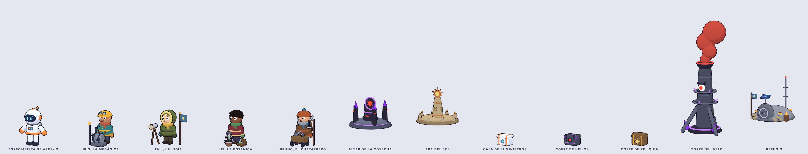

# Contenido del mapa

Cosas que poblar en el mapa además de la horda: altares de los que salen los
jefes, altares de desafío, cajas de premio, dos estructuras y la gente de Meta
trabajando junto a su refugio, con la que se habla por voz.

Dónde está cada cosa en este repo:

- **Modelos y animaciones**: `src/modelos/` (fichas técnicas en
  [ESPEC.md](ESPEC.md#mapa-fichas)).
- **Qué hace cada cosa en la partida**: `src/contenido/mapa.ts`, datos puros
  sin `three`, para que los carguen tal cual el juego y el servidor de voz
  (como `guion.ts`). Recompensas, desafíos, botín, personalidad e intenciones
  de cada NPC, frases de respaldo y dos funciones: `detectarIntencion` y
  `aQuienHabla`.
- **Pruebas**: `test/contenido.test.ts` comprueba que cada modelo y cada clip
  que cita el contenido existen, y que la voz entiende frases reales.

Las recompensas se expresan con los sistemas que ya tiene el juego: chatarra,
integridad, exposición, reliquias, pantalla de mejora, nivel de herramienta y
efectos temporales (ver el tipo `Efecto`).

## Altares de jefe

Los jefes ya no caen del cielo: **salen de su altar**. Hay tres en el mapa,
uno por jefe, con el emblema del suyo flotando encima (rueda de cuchillas,
dirigible u ojo).

| Altar | Jefe | Despierta | Recompensa | Si lo despiertas antes |
|---|---|---|---|---|
| Altar de la Cosecha | Segador, Jefe de Cosecha | minuto 3 | reliquia + 25 de chatarra + mejora (3 opciones) | +1 nivel de herramienta |
| Altar del Velo | Heraldo del Velo | minuto 5 | reliquia + integridad llena + exposición a 0 | +40 de chatarra |
| Altar del Ojo | Ojo de HELIOS | minuto 9 | reliquia + 60 de chatarra + mejora (4 opciones) | — |

1. `Reposo` mientras duerme. Desde lejos se ve su emblema girando.
2. Al llegar su minuto, o si el jugador dice **«invoca»** a menos de 6 m
   (riesgo a cambio del extra), `Invocar`: tiembla, suben anillos rojos, sale
   un **haz rojo al cielo** (1,2 s, se ve desde todo el mapa) y **el jefe
   aparece en 2,6 s** encima del altar.
3. `Combate` en bucle mientras el jefe vive.
4. Al vencerlo, `Recompensa`: el haz se apaga, los cristales púrpura se
   rompen, brotan **cristales de sol** y sube un sol dorado. **Se puede
   recoger en 2,4 s.**
5. `Purificado` hasta que el jugador lo toca; después, `Agotado`.

## Altares de desafío: el Ara del Sol

Monumentos de la gente de Meta de antes del velo (piedra cálida, sol de
cobre). Hay tres en el mapa; cada uno propone **un desafío al azar** y se
puede usar una vez por partida.

| Desafío | Reglas | Recompensa |
|---|---|---|
| Aguanta al sol | 30 s dentro del círculo | mejora (3 opciones) |
| Cosecha al revés | 40 unidades rotas dentro del círculo en 25 s | 30 de chatarra + 1 nivel de herramienta |
| Sin un rasguño | 20 s dentro del círculo sin que te toquen | +40 de integridad + escudo 30 s |
| Chispas de sol | 8 chispas recogidas en el círculo en 20 s | −30 de exposición + 15 de chatarra |
| Guardia del ara | 30 s sin que ninguna unidad toque el ara | reliquia |

1. Al acercarse, ADA lee las reglas. El jugador acepta diciendo **«acepto»** o
   pisando el círculo.
2. `Activar` (1,6 s): el sol se enciende y un **anillo de luz de 8 m** marca
   la zona en el suelo.
3. `Desafío` en bucle y, **a la vez**, `Progreso` en pausa con
   `time = progreso` (0 → 1): las ocho lámparas se encienden de una en una.
   Así el jugador ve cuánto le falta sin mirar la interfaz.
4. `Superado` (el premio sale en 0,8 s, con un estallido de rayos) o
   `Fallado` (las lámparas se apagan una a una).

## Cajas de premio

| Caja | Aparece | Se abre | Botín |
|---|---|---|---|
| Caja de suministros (blanca y naranja, de ARES-IX) | Cae en paracaídas cerca del jugador cada 2 min; el operador avisa | Acercándose, 1 s | 55 %: 12 de chatarra · 30 %: +25 de integridad · 15 %: imán ×2 durante 40 s |
| Cofre de HELIOS (chapa, grietas púrpura, cerradura con ojo rojo) | 6 por el mapa, junto a torres y altares | ADA lo piratea en 3 s y **sube la exposición 15** | 40 %: 20 de chatarra · 35 %: mejora (3 opciones) · 25 %: +1 nivel de herramienta |
| Cofre de reliquia (dorado, con un sol) | Solo como premio de un desafío o donde lo marque la vigía | Acercándose, 1,5 s | reliquia + 10 de chatarra |

Las tres comparten clips: `Aparecer` (2 s) → `Reposo` → `Abrir` (**el botín
sale en 0,5 s**) → `Abierta`. En el cofre de HELIOS, el ojo rojo de la
cerradura se apaga y se enciende cian (ADA) antes de que salte la tapa.
`tirarBotin(caja, semilla)` tira el botín.

## Estructuras

- **Torre del Velo** (4 en el mapa). Chimenea de HELIOS con un ojo, aros con
  cristales y una boca que escupe nubes rojas. Mientras está en pie, **la
  exposición sube un 20 % más rápido a 25 m**. Tiene 400 de vida: al
  derribarla (`Colapso`), cae hacia atrás, deja de echar velo y **baja el sol
  sobre ella** (2,2 s); da −40 de exposición y 20 de chatarra. Después,
  `Apagada`.
- **Refugio** (1, cerca de la salida). Cúpula medio enterrada con escotilla,
  sacos terreros, panel solar, antena, estufa y bandera del sol. A 5 m de la
  estufa se recuperan **2 de integridad por segundo**. Con enemigos a menos de
  12 m, `Alarma`: la escotilla se cierra y gira una luz roja. `Abrir` cuando
  el jugador se acerca sin peligro.

## La gente de Meta (NPC) y la voz

Cuatro supervivientes trabajan junto al refugio, cada uno con su puesto y su
oficio, y se les habla por voz como al dron:

| NPC | Puesto (clip `Trabajar`) | Qué ofrece por voz |
|---|---|---|
| **Iris, la mecánica** | Golpea un generador viejo con una llave inglesa: chispas y bombilla que parpadea | «repárame» → +40 de integridad (10 de chatarra, 2 veces) · «ajusta el dron» → +1 nivel al dron (25, 1 vez) |
| **Tali, la vigía** | Barre el horizonte con prismáticos y señala; catalejo y banderín | «¿dónde está el jefe / el cofre / la torre / el ara?» → lo marca en el minimapa · «¿qué viene?» → te cuenta la próxima oleada |
| **Lis, la botánica** | Se arrodilla junto a la última planta viva, toma una muestra y la mira a contraluz | «¿qué es esto?» → explica la última reliquia (su historia y el dato real) · «que no me vean» → −25 de exposición (1 vez) |
| **Bruno, el chatarrero** | Saca una pieza del carro, la pesa en la balanza y la echa al montón | «¿hacemos un trato?» → mejora (3 opciones) por 30 de chatarra (2 veces) · «véndeme el imán» → imán ×2 durante 40 s por 10 |

Todos entienden también «¿qué puedes hacer?», y charlan de lo que saben si no
se les pide nada concreto.

### Cómo va una conversación

1. **El jugador se acerca a 6 m**: el NPC deja de trabajar, se gira hacia él
   (el juego gira el nodo `giro`, que ningún clip toca, así el puesto se queda
   quieto) y pone `Saludar`. Suena su frase de `saludo`.
2. **A 4 m, el jugador habla** (la misma tecla o botón de voz que el dron).
   Mientras graba, el NPC pone `Escuchar`.
3. **¿A quién habla?** `aQuienHabla(texto, npcsCerca)`: si nombra a alguien
   («Tali, …»), a ese; si da una orden del dron («escanea», «ven», «quieto»,
   «luz») sin nombrar a nadie, al dron; si no, al NPC más cercano.
4. **¿Qué pide?** `detectarIntencion(npc, texto)` busca sus palabras clave
   (sin tildes ni mayúsculas). Si encuentra una intención, el juego comprueba
   el coste (chatarra) y las veces que le quedan; si no puede, usa la frase
   `sinChatarra` o `yaNoQueda`.
5. **Responde**: el servidor pide a Muse una respuesta con
   `contextoVoz(npc, intencion)` (su voz, lo que sabe, lo que puede ofrecer)
   y lo que dijo el jugador **como dato** (`limpiarDato`). Mientras suena,
   `Hablar`. Si la intención entrega algo, `Dar`: el objeto aparece en sus
   manos de 0,35 a 0,95 s y luego pasa al jugador. Sin red o sin cupo, se usa
   `frase(npc, intencion, semilla)`.
6. **El efecto lo decide la intención, nunca el modelo**: Muse solo redacta.
   Así nadie convence a Bruno de que regale mejoras.
7. Al alejarse (despedida) vuelve a `Trabajar`. Con enemigos a menos de 10 m,
   `Asustarse` (y la frase `asustado`). Cuando vuelve el sol, `Celebrar`.

## Colocación sugerida

En metros desde la salida del jugador, en el mapa de 180 × 180 m
(`COLOCACION` en `mapa.ts`):

| Qué | Cuántos | Distancia | Separación mínima |
|---|---|---|---|
| Refugio | 1 | 12–18 m | — |
| NPC | 4 | a 4–9 m del refugio | — |
| Altares de jefe | 3 | 45–70 m | 50 m |
| Aras del Sol | 3 | 25–60 m | 30 m |
| Torres del Velo | 4 | 35–80 m | 35 m |
| Cofres de HELIOS | 6 | 20–85 m | 15 m |

## Qué hay que hacer en el juego

Este repo solo modela y define el contenido. En el juego falta:

1. Copiar los modelos nuevos (`gente.ts`, `npc-*.ts`, `altar-*.ts`,
   `caja-premio.ts`, `torre-velo.ts`, `refugio.ts`, y `kit.ts` actualizado) y
   `src/contenido/mapa.ts`.
2. Colocarlos al empezar la partida (`COLOCACION`), cada uno con su
   `AnimationMixer` (son pocos; las cajas pueden ir con `Tropa` si hay muchas).
3. Hacer que los jefes salgan de su altar (`ALTARES_JEFE`) y aplicar los
   efectos (`Efecto`) con los sistemas que ya existen.
4. Lógica de los desafíos (`DESAFIOS`): contar, cronometrar y mover
   `Progreso`.
5. En el servidor de voz: enrutar con `aQuienHabla`, decidir con
   `detectarIntencion` y redactar con `contextoVoz`, con las frases de
   respaldo cuando no haya IA.
