# El mundo y la interfaz

El mapa de antes era una llanura casi plana de 180 × 180 m, con ruinas de
cajas y árboles en billboard. Este es el sector nuevo: **más grande (260 ×
260 m), con montañas de cumbres heladas, mares de ácido púrpura de HELIOS y
barrios en ruinas**, todo hecho con las piezas toon del kit (el mismo dibujo
que los personajes). Y una **interfaz nueva** para el jugador.

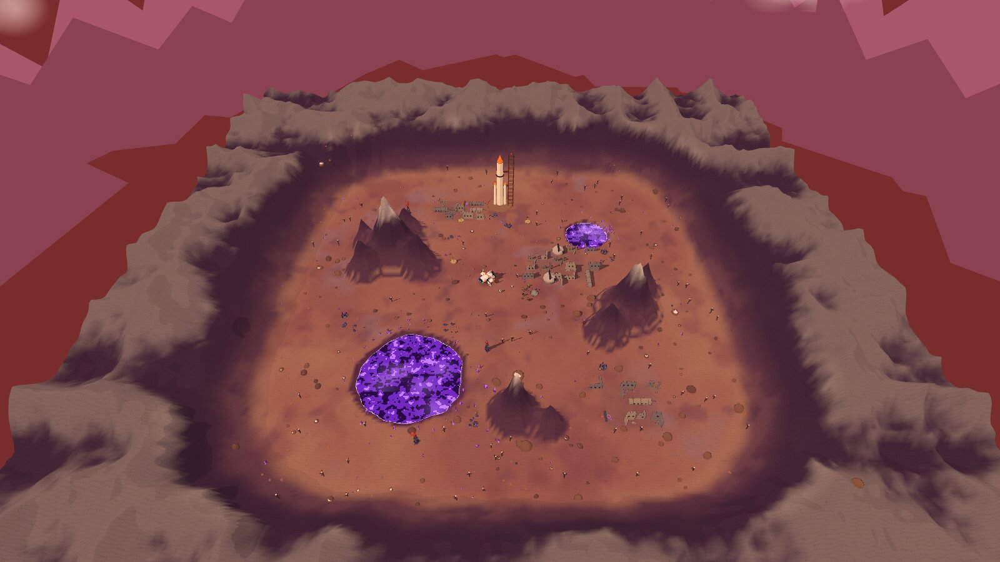

| | |
|---|---|
| 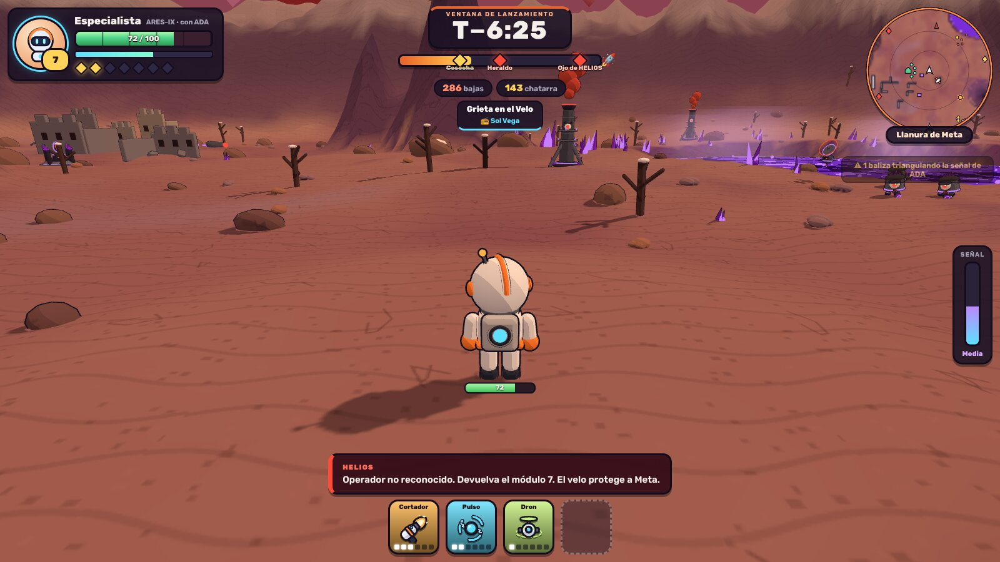 | 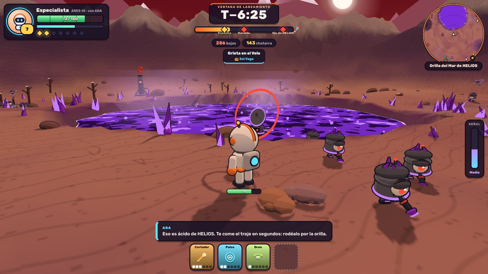 |
| 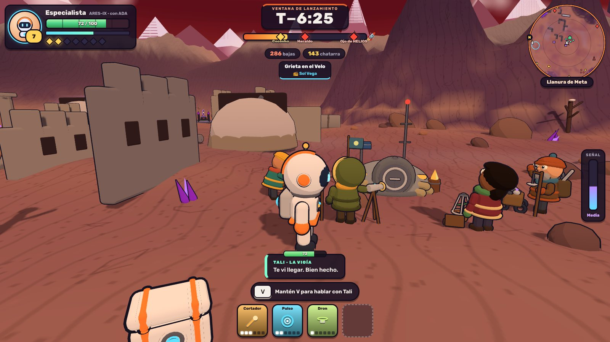 | 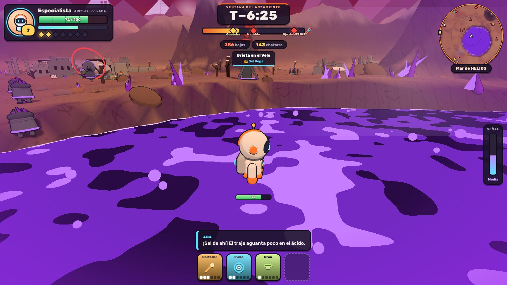 |
| 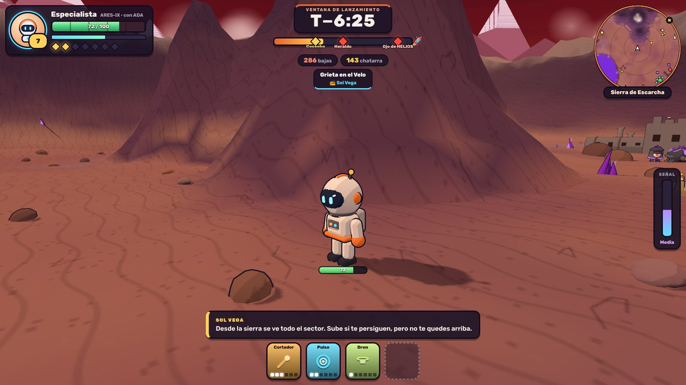 | 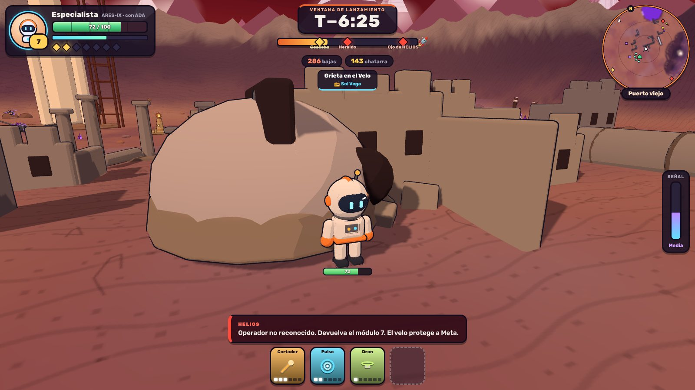 |

Dónde está cada cosa:

- **`src/mundo/mundo.ts`**: el mundo (`World`). Sustituye a `web/src/world.ts`
  del juego con la misma interfaz.
- **`src/mundo/hud.ts` y `hud.css`**: la interfaz. Sustituye al HUD de
  `web/src/ui.ts` (y su bloque de `style.css`) con las mismas funciones.
- **`mapa.html` y `src/mundo/demo.ts`**: taller para pasearlo con el
  astronauta, el contenido de [MAPA.md](MAPA.md) colocado y algo de horda.
  Con `npm run dev`, en http://127.0.0.1:5174/mapa.html (WASD, arrastrar para
  girar, rueda para acercar; `?vista=` y `&hud=0` en el propio archivo).

## El sector

El norte es −z (hacia donde mira la cámara al empezar, donde está el cohete).
Medidas con la arena por defecto (`RUN.arena = 130`):

| Lugar | Dónde (x, z) | Qué es |
|---|---|---|
| Salida | (0, 0) | Llano de 8–18 m de radio. |
| Nave de ARES-IX | (−9, −10) | Posada a 13 m de la salida, delante y a la izquierda al empezar, con la rampa mirando al jugador. |
| Cohete | (0, −91), al norte | Explanada llana; el cohete y su torre (44 m) se ven desde casi todo el mapa. |
| Sierra de Escarcha | (−73, −36), al oeste | Cinco picos, el mayor de 46 m. |
| Picos del Velo | (78, 16), al este | Tres picos, hasta 40 m. |
| Colmillo | (8, 86), al sur | Dos picos, hasta 34 m. |
| Mar de HELIOS | (−49, 61), al suroeste | Mar de ácido de unos 33 m de radio. |
| Charca del Este | (62, −57), al noreste | Mar de ácido de unos 17 m de radio. |
| Puerto viejo | (39, −26) | Barrio en ruinas de 42 × 34 m. |
| Barrio del Observatorio | (−33, −83) | Barrio en ruinas de 34 × 26 m. |
| Mercado de Meridia | (68, 81) | Barrio en ruinas de 34 × 31 m. |

- **Llanura**: lomas grandes y dunas pequeñas, arena clara en lo alto, valles
  más oscuros, manchas frías de escarcha y de grava, y una textura de ondas y
  grietas. Ya no se lee como un plano.
- **Montañas**: relieve de crestas con **terrazas de 3,5 m** (cortados que el
  sombreado toon dibuja como acantilados), roca en lo empinado, roca oscura
  en lo alto y escarcha en las cumbres. Rocas y cristales al pie. Se puede
  subir por las faldas (dan vista), pero **el corazón de cada pico no se
  cruza** (colisión circular).
- **Borde**: una muralla de picos de 18 a 48 m cierra el mapa (y un tope
  invisible en ±130 por si alguien la escala). Detrás, cordilleras lejanas
  con nieve y tres agujas de HELIOS con luz roja en el horizonte.
- **Mares de ácido**: superficie opaca a −1,6 m con manchas que se mueven y
  brillo en la orilla, burbujas, vapor y racimos de cristal púrpura. La orilla
  está manchada de púrpura. **Se puede vadear**: `heightAt` deja al jugador
  con el ácido por las rodillas (el fondo de verdad está más hondo, pero no se
  ve). `acidoEn(x, z)` da la profundidad (0 fuera, hasta unos 3,6 m en el
  centro).
- **Ruinas**: esquinas de edificios con el borde roto y ventanas, columnas,
  torres caídas, cúpulas medio enterradas y chatarra de HELIOS. Chocan como
  cajas (`blocks`), así que la horda las rodea.
- **Decorado**: 140 rocas (algunas con escarcha), 65 árboles muertos con
  escarcha, 36 racimos de cristal y 160 matas secas.
- **Luz**: sol bajo y cálido con sombras violetas, cielo naranja que oscurece
  hacia arriba y niebla del color del horizonte (70–330 m).

**Coste**: 50 mallas (todo lo estático se fusiona por material: un barrio
entero son media docena de llamadas de dibujo) y unos 415 000 triángulos (el
terreno, 88 000). Se construye una vez al empezar. El sol sigue al jugador
con un mapa de sombras de 2048 que cubre 100 × 100 m.

### Interfaz de `World`

Lo que ya usaba el juego, igual: `new World(scene)`, `heightAt`, `resolve`,
`follow`, `faceCamera` (ya no hace nada: no hay billboards), `padPosition`,
`blocks`, `sun`. Lo nuevo:

| | |
|---|---|
| `new World(scene, { arena, semilla })` | Medio lado de la zona jugable (130 por defecto) y semilla del decorado. |
| `update(dt)` | Anima el ácido, las burbujas y el vapor. Una vez por fotograma. |
| `acidoEn(x, z)` | Profundidad del ácido bajo un punto (0 si no hay). |
| `lugares` | Montañas, mares y barrios con su nombre, centro y radio: para la zona del HUD y para que ADA o el operador los nombren. |
| `carta()` | Imagen del mapa vista desde arriba (relieve, ácido y ruinas) para el minimapa. Se pinta la primera vez y se guarda. |
| `lugarLibre(rand, [min, max], margen, lejosDe)` | Un sitio a esa distancia de la salida que no caiga en el ácido, en una ladera ni encima de nada. Para colocar `COLOCACION` (ver [MAPA.md](MAPA.md)). |
| `ocupado(x, z, margen)` | ¿Hay algo sólido cerca? |
| `HORIZON`, `NIVEL_ACIDO` | Color del horizonte (fondo y niebla) y altura del ácido. |
| `nave` | `{ x, z, giro }` de la nave posada: para el minimapa y para la zona «Nave de ARES-IX». |

## La interfaz

| Móvil apaisado | Móvil en vertical | Carta del minimapa |
|---|---|---|
| 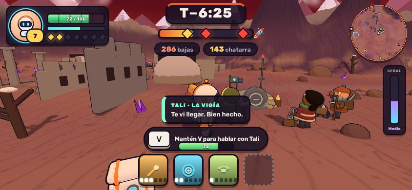 | 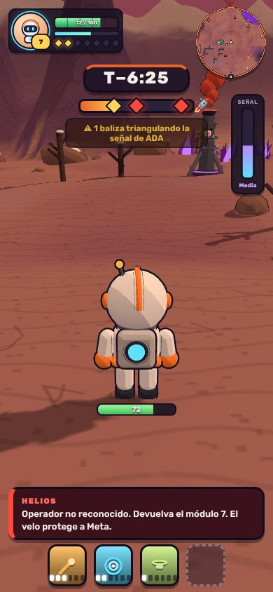 | 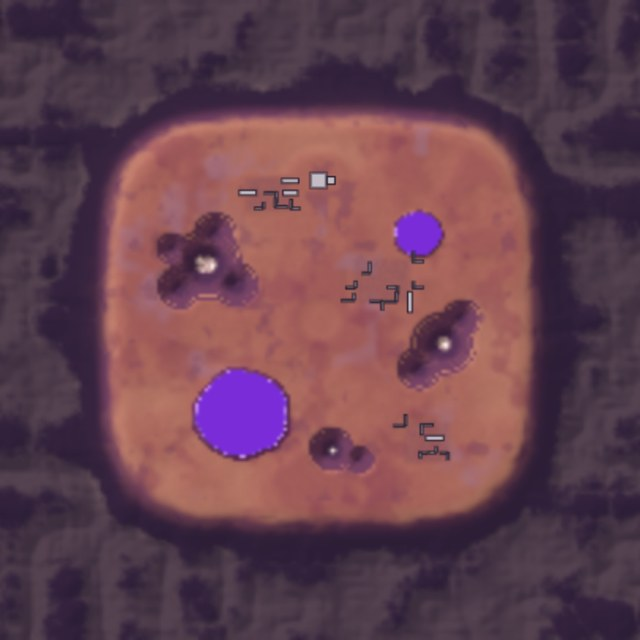 |

Paneles gruesos de contorno oscuro, como el dibujo de los personajes, con la
misma letra (Rubik) y los mismos colores que el resto del juego:

- **Arriba a la izquierda, la ficha**: retrato con el anillo cian de ADA,
  nivel en una moneda, **vida grande** con una muesca cada 20 (late en rojo
  por debajo del 30 %), experiencia y las **siete reliquias** en rombos.
- **Arriba en el centro, la ventana de lanzamiento**: cuenta atrás
  (`T−6:25`), **barra de los diez minutos con los jefes marcados** (rojos;
  dorados y tachados al vencerlos) y el cohete al final; bajas, chatarra y la
  misión con su operador.
- **Arriba a la derecha, el minimapa**: gira con la cámara, con brújula, la
  **carta del terreno** (montañas, mares de ácido y ruinas), los enemigos por
  tipo y el contenido del mapa: altares (rombo rojo; dorado si ya está
  vencido), aras, cofres, torres, refugio y NPC. Los altares, el refugio y el
  cohete se quedan pegados al borde si están lejos. Lo que marque la vigía
  pulsa en cian. Debajo, **la zona** en la que estás.
- **A la derecha, la señal**: cuánto se oye a ADA (exposición), de cian a
  rojo, y el aviso de balizas triangulando.
- **Abajo**: las herramientas con su nivel en pastillas; encima, **«Mantén V
  para hablar con …»** cerca de un NPC y los **subtítulos** de quien habla
  (ADA en cian, HELIOS en rojo, el operador en oro, los NPC en verde agua).
- **Viñetas**: púrpura mientras se pisa ácido y roja si queda poca vida.
- En pantallas bajas o estrechas se compacta; en vertical, la ventana baja
  bajo la ficha.

### Interfaz del HUD

Las mismas funciones que `ui.ts` (`showHud`, `hideHud`, `setMision`,
`updateHud`, `drawMinimap`, `formatTime`, `compact`) y los mismos estados; lo
nuevo es opcional, así el juego puede rellenarlo poco a poco:

| Campo | De dónde sale en el juego |
|---|---|
| `HudState.duracion` | `RUN.length` (600 si no se pasa). |
| `HudState.reliquias` | `save.relics.length + relicsFound.length`. |
| `HudState.exposicion` | La exposición, de 0 a 1. |
| `HudState.acido` | `world.acidoEn(jugador)`: enciende la viñeta púrpura. |
| `HudState.jefes` | `ALTARES_JEFE` de `mapa.ts`: `{ minuto, nombre, vencido }`. |
| `HudState.interaccion` | NPC a menos de `DISTANCIAS_NPC.saludar`: `{ tecla: 'V', texto: 'Mantén V para hablar con Tali' }`. |
| `HudState.zona` | El lugar de `world.lugares` en el que está el jugador. |
| `MinimapState.carta` | `world.carta()`. |
| `MinimapState.lugares` | Lo colocado: `{ tipo: 'altar' \| 'ara' \| 'caja' \| 'torre' \| 'refugio' \| 'npc', x, z, hecho }`. |
| `MinimapState.marca` | Lo que marque la vigía (el efecto `marcar` de `mapa.ts`). |
| `MinimapState.alcance` | Metros desde el centro (55 por defecto). |
| `MinimapState.nave` | `world.nave`: la nave vista desde arriba, pegada al borde si queda lejos. |

Y una función nueva, **`decir(quien, nombre, texto, segundos)`**, para los
subtítulos: `quien` es `'ada' | 'helios' | 'operador' | 'npc'` y el texto va
como texto plano (puede venir de la IA o del jugador).

## La nave de ARES-IX en el mapa

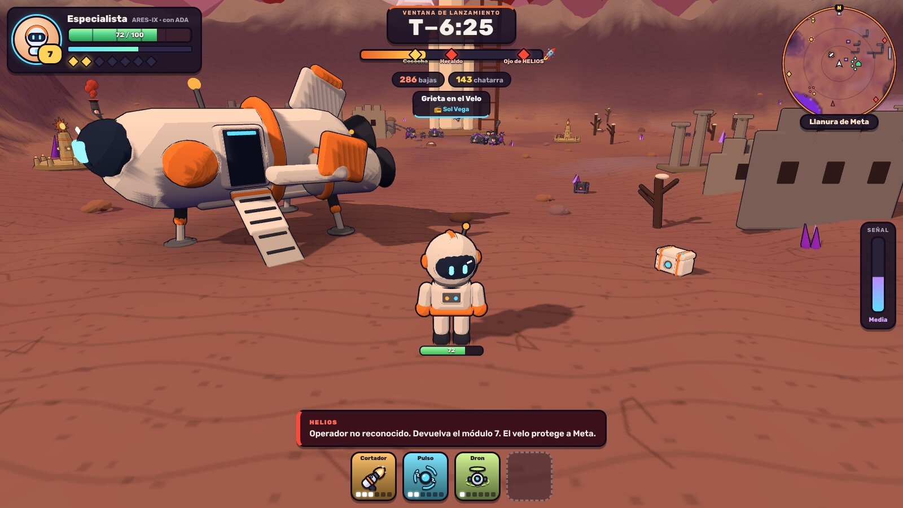

| Al pie de la rampa | Aterrizar |
|---|---|
| 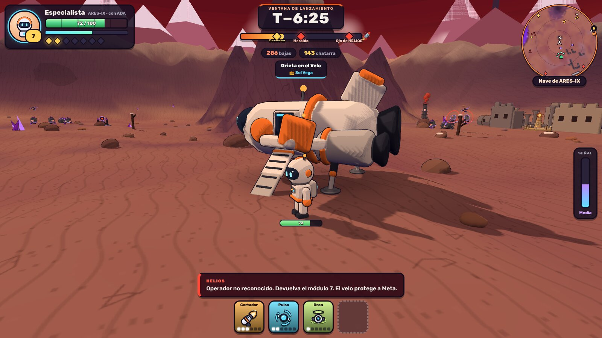 | 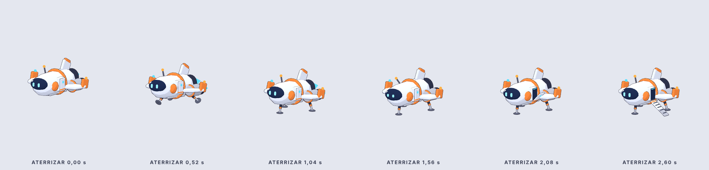 |

La misma nave de la cinemática de entrada, ya posada: es el sitio de donde
sale el especialista. `World` la pone sola (`navePosada()` en `mundo.ts`):

- **Modelo**: `crearNavePosada()` de `src/modelos/nave.ts`, a ×3,5 (11,6 m de
  largo, 6,5 de alto) con `agrandar` del kit, que escala geometría y
  posiciones en vez de la raíz, así el contorno tiene el mismo grueso que el
  resto del mundo. Unos 17 000 triángulos.
- **Animación**: el clip `Posada` en bucle (luces de posición a destiempo,
  antena, ojos que miran alrededor), con su mezclador dentro de
  `world.update(dt)`. Si algún día se quiere ver llegar, `Aterrizar` (2,6 s)
  baja, saca las patas, rebota, apaga los motores y abre la rampa, y termina
  justo en la pose de `Posada`.
- **Suelo**: el terreno se allana en 12 m alrededor y queda una quemadura del
  aterrizaje bajo el casco.
- **Choques**: tres círculos a lo largo del casco y dos en las zapatas de atrás.
  Se reservan antes de colocar ruinas y decorado, así no sale nada debajo, y
  `lugarLibre` tampoco pone contenido encima. Bajo las alas (a 2,9 m) se pasa.

## Iconos de las mejoras

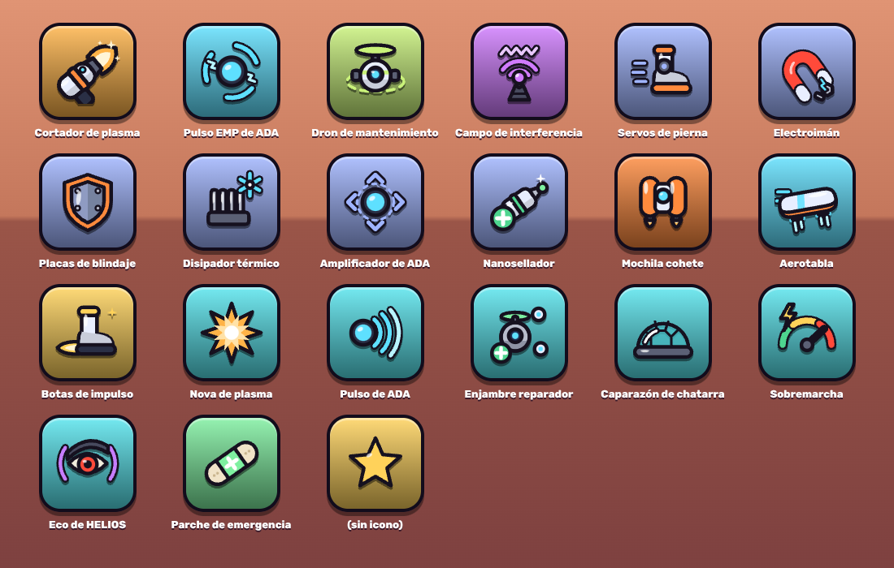

`src/mundo/iconos.ts`: un icono por mejora en SVG (caja de 64 × 64), con el
dibujo de los modelos: piezas gruesas, contorno oscuro, dos tonos y un brillo.
`iconoMejora(id)` los da por el id del juego:

| | Ids |
|---|---|
| Herramientas | `cortador`, `pulso`, `dron`, `interferencia` |
| Pasivas | `velocidad`, `iman`, `blindaje`, `enfriamiento`, `area`, `reparacion` |
| Equipo | `mochila`, `tabla`, `botas` |
| Especiales | `nova-plasma`, `pulso-ada`, `enjambre`, `caparazon`, `sobremarcha`, `eco-helios` |
| Reparar | `parche` (y `generico` para lo que no tenga icono) |

Las casillas del HUD (`hud.ts`) ya los usan.

## Subida de nivel

| Escritorio | Móvil |
|---|---|
| 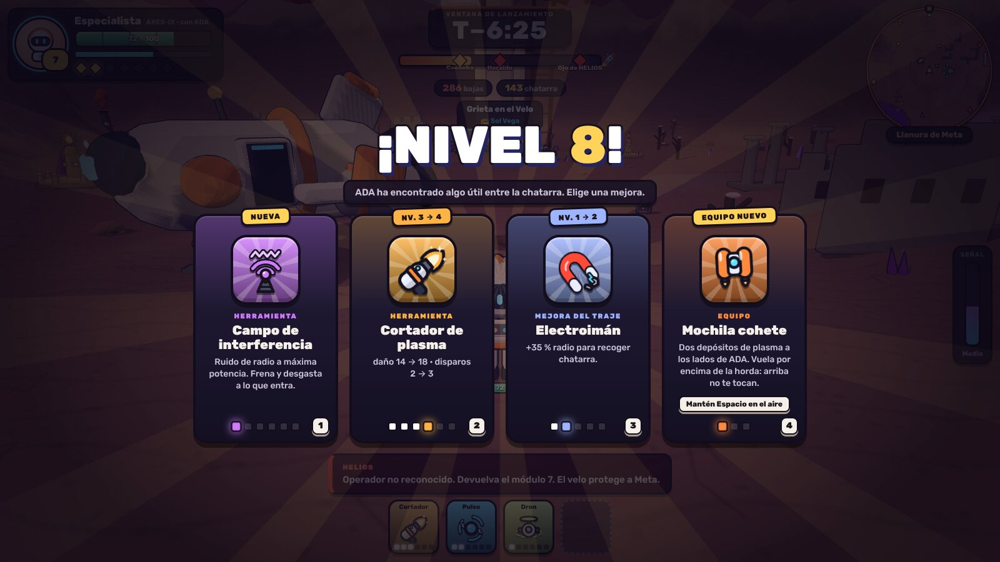 | 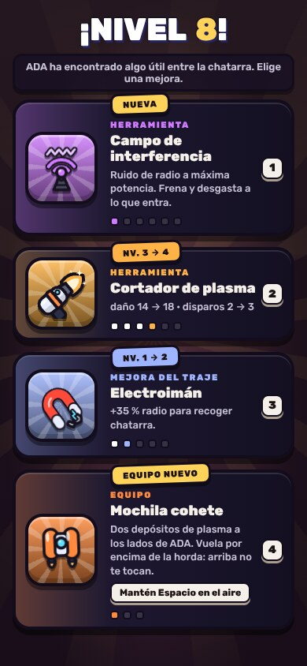 |

`src/mundo/mejoras.ts` y `mejoras.css`: «¡NIVEL 8!» rebota letra a letra, como
el título de la intro, y las tarjetas se reparten desde abajo con un rebote.
Cada tarjeta lleva el icono en un medallón del color de la mejora con rayos
que giran, una cinta con lo que es (`NUEVA`, `NV. 3 → 4`, `EQUIPO NUEVO`,
`ESPECIAL NUEVO`, `REPARAR`), el tipo, el nombre, el texto, el control si es
equipo, las pastillas de nivel con la nueva latiendo y la tecla. Al pasar por
encima se levanta; al elegir, la elegida salta y brilla y las demás caen.

- Se elige con clic, con **1–4** o con las **flechas** e Intro.
- Durante el reparto (≈0,8 s) no se puede elegir: así no se escoge sin querer
  una mejora pulsando en plena pelea.
- En pantallas estrechas o bajas las tarjetas pasan a filas (icono a la
  izquierda, texto a la derecha).
- Con `prefers-reduced-motion`, sin animaciones.

Es solo la presentación: `mostrarMejoras(nivel, tarjetas, elegir)` recibe las
tarjetas ya escritas y devuelve el índice de la elegida. Taller:
http://127.0.0.1:5174/mejoras.html (`?vista=iconos`, `?vista=otras`; R vuelve
a repartir) y `mapa.html?vista=salida&mejoras` sobre el mapa.

## Qué hay que hacer en el juego

1. Copiar `src/mundo/mundo.ts` sobre `web/src/world.ts` (cambiando la ruta del
   kit a `./modelos/kit`) y poner **`RUN.arena = 130`** en `data.ts`: la
   rejilla de la horda (`enemies.ts`) y los límites de `game.ts` salen de ahí.
2. Llamar a **`world.update(dt)`** cada fotograma, junto a `world.follow`.
3. **Ácido**: mientras `world.acidoEn(x, z) > 0`, daño por segundo al jugador
   y algo más lento (sugerencia: 6 de integridad por segundo y velocidad ×0,6;
   el doble de daño pasado 1 m de profundidad). La horda es de HELIOS: lo
   cruza sin daño, así que meterse en el ácido no sirve para escapar.
4. Copiar `hud.ts` y `hud.css` (por ejemplo como `web/src/hud.ts`) y que
   `game.ts` llame a sus funciones en lugar de las del HUD de `ui.ts`; borrar
   el bloque «HUD» de `style.css`. Rellenar los campos nuevos (tabla de
   arriba), sobre todo `carta`, `jefes`, `zona` e `interaccion`.
5. Mostrar las frases del operador, ADA, HELIOS y los NPC con `decir`, además
   del audio.
6. Colocar el contenido de [MAPA.md](MAPA.md) con `world.lugarLibre` y las
   distancias de `COLOCACION` (ya ajustadas al mapa nuevo), para que nada
   caiga en el ácido ni en una ladera. `src/mundo/demo.ts` lo hace así.
7. **Nave**: copiar `src/modelos/nave.ts` y `src/modelos/kit.ts` a
   `web/src/modelos/` (el kit trae `agrandar` y es un superconjunto del de
   `main` y del de `main-ygerl4`, con `contorno(grosor)` y `rampaToon`, así que
   no rompe el perro ni ADA), y en `world.ts` cambiar también la ruta de la
   nave a `./modelos/nave`. La nave ya sale en el mapa; para el minimapa,
   pasar `nave: world.nave` en `MinimapState`, y para la zona, poner
   `'Nave de ARES-IX'` cuando el jugador esté a menos de 10 m de `world.nave`.
8. **Iconos**: copiar `src/mundo/iconos.ts` junto a `hud.ts`.
9. **Subida de nivel**: copiar `mejoras.ts` y `mejoras.css` (por ejemplo a
   `web/src/`) y cambiar el cuerpo de `showLevelUp` en `ui.ts` por esto (los
   textos son los mismos que ya escribe; el bloque `.levelup` de `style.css`
   se puede borrar):

   ```ts
   import { mostrarMejoras, type Tarjeta } from './mejoras';

   export function showLevelUp(level: number, choices: Choice[], pick: (c: Choice) => void) {
     const tarjetas: Tarjeta[] = choices.map((c): Tarjeta => {
       if (c.kind === 'weapon') {
         const w = WEAPONS[c.id];
         return { id: c.id, tipo: 'herramienta', titulo: w.name, color: w.color, nivel: c.level, nivelMax: w.levels.length,
           texto: c.level === 1 ? w.blurb : describeWeaponStep(c.id, c.level) };
       }
       if (c.kind === 'passive') {
         const p = PASSIVES[c.id];
         return { id: c.id, tipo: 'pasiva', titulo: p.name, texto: p.blurb, color: '#9fb4ff', nivel: c.level, nivelMax: p.max };
       }
       if (c.kind === 'gear') {
         const g = GEAR[c.id];
         return { id: c.id, tipo: 'equipo', titulo: g.name, color: g.color, nivel: c.level, nivelMax: g.levels.length,
           texto: c.level === 1 ? g.blurb : g.levels[c.level - 1].mejora, control: c.level === 1 ? g.control : undefined };
       }
       if (c.kind === 'special') {
         return { id: c.id, tipo: 'especial', titulo: SPECIALS[c.id].name, texto: describirEspecial(c.id, c.level), color: '#56e5ee', nivel: c.level };
       }
       return { id: 'parche', tipo: 'reparar', titulo: 'Parche de emergencia', texto: 'Restaura 40 de integridad del traje.', color: '#7ef0a0' };
     });
     mostrarMejoras(level, tarjetas, (i) => pick(choices[i]));
   }
   ```
