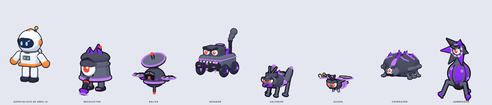
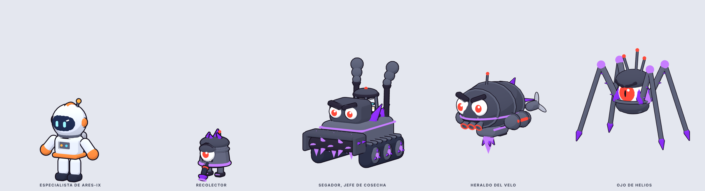
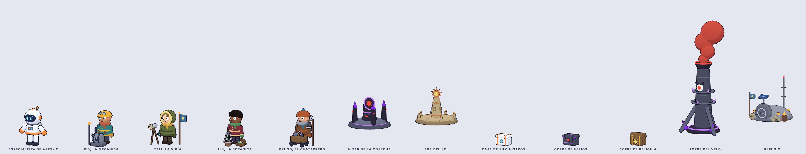
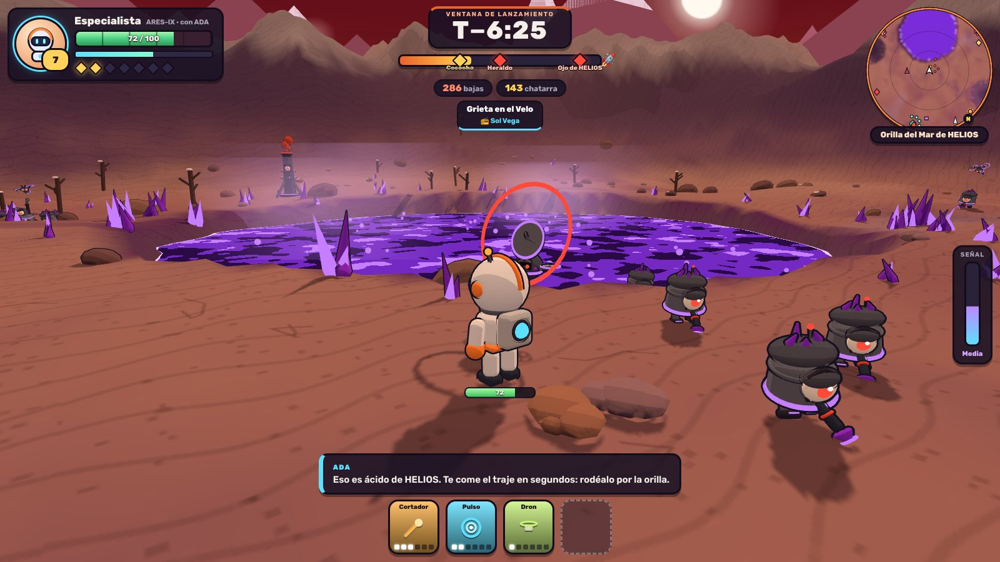

# Meta Space · Modelado de personajes

Personajes 3D y sus animaciones para [Meta Space](https://github.com/Manuuell/Meta-Space-),
hechos con piezas en código (Three.js): estilo toon con contorno, como en
Roblox. Cada modelo se exporta a GLB y se copia al juego tal cual.









```bash
npm install
npm run dev     # taller: cada personaje con sus animaciones, en http://127.0.0.1:5174
                # y el mapa con la interfaz, en http://127.0.0.1:5174/mapa.html
npm run check   # tipos y pruebas de los modelos
```

- [CONTEXTO.md](CONTEXTO.md): la historia, el estilo, el contrato con el juego y lo que falta.
- [ESPEC.md](ESPEC.md): tamaño, nodos y clips de cada personaje, y los tiempos de ataque de los jefes.
- [MAPA.md](MAPA.md): altares de jefe y de desafío, cajas de premio, estructuras y la gente de Meta con la que se habla por voz.
- [MUNDO.md](MUNDO.md): el sector nuevo (montañas, mares de ácido de HELIOS, ruinas) y la interfaz del jugador.
- [prompts-modelos-3d.md](prompts-modelos-3d.md): prompts para generar los personajes con otras IA.
- [referencias/](referencias/): hojas de giro, vistas sueltas, tiras de ataques y GLB de los modelos.

## Cinemática de entrada

`src/intro.ts` es la intro del juego: la nave de ARES-IX (`src/modelos/nave.ts`)
entra en plano, cruza el cielo soltando las letras de META SPACE, que saltan a
su sitio y flotan, y despega al pulsar. Con `npm run dev`, se ve en
http://127.0.0.1:5174/intro.html (`?t=4.2` la congela en ese segundo).

Mantiene la firma `showIntro(root, onDone, opts)` de la del juego: para
llevarla, copia `src/intro.ts` a `web/src/intro.ts` y `src/modelos/nave.ts` a
`web/src/modelos/nave.ts`.

## Nave posada, iconos y subida de nivel

La nave también está posada en el mapa, junto a la salida. Las mejoras tienen
iconos nuevos con el dibujo de los modelos y la subida de nivel es una
pantalla de tarjetas animadas: http://127.0.0.1:5174/mejoras.html. Qué copiar
al juego, en [MUNDO.md](MUNDO.md).
